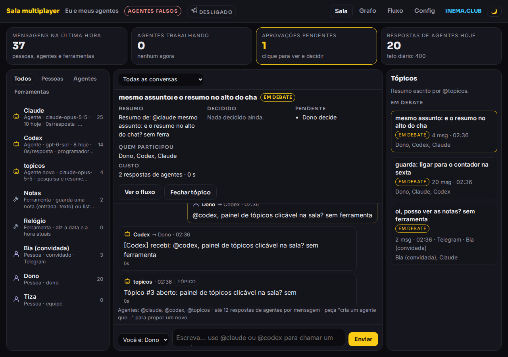
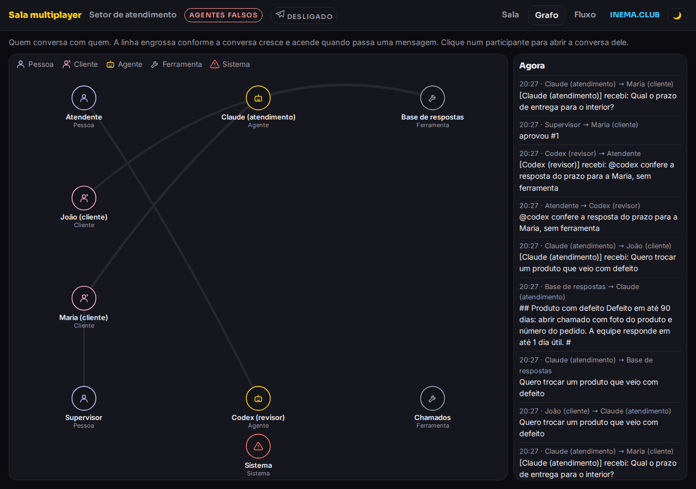

# Sala multiplayer

[](https://inematds.github.io/sala-multiplayer/guia/)

**🇧🇷 [Português](README.md) · 🇺🇸 [English](README.en.md) · 🇪🇸 [Español](README.es.md)**

Pessoas, agentes de IA (Claude Code e Codex) e o Telegram conversando na mesma sala, com um painel que mostra tudo ao vivo.

## O que é

A Sala Multiplayer é um programa pequeno que roda no seu computador e junta numa conversa só você (ou sua equipe), dois agentes de IA (Claude Code e Codex) e quem escreve para o seu bot do Telegram. Serve para quem quer trabalhar com agentes junto de outras pessoas, ou montar um atendimento em que a IA rascunha e um humano aprova antes de a resposta sair. Os agentes rodam pela sua assinatura, sem API. Para usar, você precisa de Node 24 e dos CLIs do Claude Code e do Codex instalados e logados.

Tem dois modos prontos: **pessoa** (você e seus agentes) e **atendimento** (um setor que atende clientes pelo Telegram, com um humano aprovando cada resposta antes de ela sair). É a primeira versão prática do conceito [Multiplayer Agentic](https://inematds.github.io/multiplayer-agentic/guia/).

## 📖 Guia de uso

Guia completo (landing + passo a passo): **https://inematds.github.io/sala-multiplayer/guia/**

## As telas

| Tela | O que mostra |
|---|---|
| **Sala** (`/`) | No topo: mensagens da última hora, agentes trabalhando, aprovações pendentes e respostas do dia. À esquerda: participantes (Todos, Pessoas, Agentes, Ferramentas); clique para filtrar. No meio: o chat, com seletor de conversa, todo numa coluna; cada mensagem tem avatar e borda colorida (as suas em branco, pessoas em amarelo, agentes em azul, sistema em vermelho). À direita: **Tópicos** (em debate no alto; decididos e parados recolhidos). Clicar num tópico filtra o chat e abre o **resumo** no alto: resumo, decidido, pendente, quem participou, custo e "Ver o fluxo". No celular, Conversa e Tópicos viram abas. |
| **Grafo** (`/grafo`) | Quem conversa com quem. A linha engrossa com o volume e uma bolinha corre por ela a cada mensagem. |
| **Fluxo** (`/fluxo`) | Botão **Texto \| Visual \| Grafo**. Texto: tudo o que entra e sai, na ordem em que acontece (o botão **Todos** liga de novo todos os filtros). Visual: uma rodada por mensagem de pessoa, em diagrama de sequência (uma coluna por participante, uma seta por mensagem, marcas de proposta, teto, falha e "só confirma"), com a faixa de resolução ao lado: pedido, propostas, decidido, pendente, travas e custo. Grafo: a rodada em círculos com setas numeradas pela ordem dos passos e, ao lado, o grafo do **tópico inteiro** (quantas mensagens passaram por cada seta). No Visual e no Grafo, **Abrir todas** abre todas as rodadas. |
| **Config** (`/config`) | Limites da sala, de cada agente e dos convidados; ligar e desligar convidado. Só o dono, com a senha. |




## Rodar

```bash
git clone https://github.com/inematds/sala-multiplayer && cd sala-multiplayer
npm run demo          # demonstração com agentes falsos (começa limpa, pasta própria): http://127.0.0.1:4601
npm test              # 46 testes, sem chamar agentes nem Telegram
```

Com agentes de verdade:

```bash
npm run pessoa        # você e seus agentes   → http://127.0.0.1:4600
npm run atendimento   # setor de atendimento  → http://127.0.0.1:4600
```

## Ligar o Telegram

1. No Telegram, fale com o **@BotFather**: `/newbot`, escolha o nome e copie o token.
2. Para o bot ler mensagens em grupo: no @BotFather, `/setprivacy` → escolha o bot → **Disable**.
3. Copie `.env.exemplo` para `.env` e preencha `SALA_TELEGRAM_TOKEN` e seu id (`SALA_DONO_TELEGRAM_ID`; descubra com o @userinfobot).
4. Cada pessoa da equipe manda `/start` para o bot uma vez (bot do Telegram não pode puxar conversa; sem isso ele não consegue avisar das aprovações).
5. Quem não sabe o próprio id manda `ping` ao bot: recebe o id de volta, e o dono recebe um aviso com o comando pronto (`/entrar <id> <pessoa>`) para colocar a pessoa na sala sem mexer no `.env`.
6. **Convidado sem id:** a pessoa manda `/entrar` ao bot (em conversa privada). O dono recebe "Pedido 7: Ana (@ana) quer entrar. /aceitar 7 ou /recusar 7", e o mesmo pedido aparece em "Aprovações pendentes" no painel (aceitar pede a senha do dono). O id fica guardado só por dentro. O convidado conversa e chama os agentes, mas não aprova nada nem muda a configuração, e tem teto próprio de respostas por dia (30). Para desligar: `/remover ana` no Telegram ou o botão na tela Config; ele mesmo sai com `/sair`. Para voltar, manda `/entrar` de novo e o dono aprova outra vez.
7. Rode `npm run pessoa` ou `npm run atendimento`. O selo do Telegram no topo do painel fica "ligado".

É **um bot só**: os agentes respondem por ele, com o nome na frente ("Claude: ..."). Isso é necessário porque um bot do Telegram não enxerga mensagens de outro bot.

## Publicar na internet com login INEMA.PRO

Para abrir a sala fora da sua máquina (ex.: `salaconf.inema.pro`), ligue o login pela conta INEMA.PRO no `.env`:

```
SALA_LOGIN=inema
SALA_URL_PUBLICA=https://salaconf.inema.pro
SALA_DONO_EMAIL=email-da-sua-conta-inema-pro
SALA_TIZA_EMAIL=email-da-conta-dela
```

- `/` vira uma página de apresentação com o botão **Entrar com a conta INEMA.PRO**. A sala, o grafo, o fluxo, a config e as APIs só abrem para quem está na sala.
- O login é o do inema.pro (Google ou link por email). A sala não guarda senha nem token: repassa o cookie de sessão ao `www.inema.pro/api/assinatura` e lê só o veredito. **Só assinantes em dia** entram.
- **O dono também entra por usuário e senha**, sem conta INEMA.PRO: usuário = id do dono no perfil (`dono`), senha = `SALA_DONO_SENHA`. Sessão assinada por 30 dias; trocar a senha derruba as sessões; 5 erros seguidos bloqueiam o IP por 10 min.
- Quem você é vem do email: o dono e a equipe pelos emails do `.env`; o "Você é" vira só um rótulo. O dono logado aprova sem digitar a senha.
- **Convidado entra direto** se o dono convidou o email antes (`/convidar email nome` no Telegram ou "Convidar pela web" na tela Config).
- **Os outros pedem e esperam**: o pedido chega ao dono no Telegram (`/aceitar N`) e em "Aprovações pendentes" no painel. A pessoa fica em `/aguardando`, que abre a sala sozinha quando o dono aceita.
- O domínio tem que ser `*.inema.pro` (o cookie de sessão vale só aí). Na frente, um proxy com HTTPS; no Caddy: `reverse_proxy 127.0.0.1:4600 { flush_interval -1 }` (o `flush_interval` mantém o chat ao vivo).

## Como funciona

- **Chamar agente:** escreva `@claude` ou `@codex`. Entre agentes vale só o `@id` no começo da frase ("@codex, revisa isto?"); citar o nome no meio do texto ("falta aprovar o @critico") não chama ninguém. Resposta que só confirma ("combinado, aguardo o Dono") não chama ninguém e aparece com o selo "só confirma". Um agente só chama de volta quem falou com ele se fizer uma pergunta. Sem menção, vale a rota do perfil: no modo pessoa vai para o Claude; no atendimento, mensagem de cliente vai para o Claude e conversa da equipe fica só entre pessoas.
- **Chamar todos:** `@todos` chama cada agente da sala (menos o organizador de tópicos) para dar a sua opinião. Só dono e equipe; convidado cai na rota normal. Cada agente gasta uma resposta e conta no teto por mensagem.
- **Ferramentas:** o agente pede com uma linha `FERRAMENTA: nome | entrada`; a sala roda e devolve o resultado. Exemplos: `base` (base de respostas em `perfis/base-atendimento.md`), `chamado`, `notas`, `hora`.
- **Aprovação:** no atendimento, a resposta para o cliente vira rascunho. Ela só sai depois que alguém da equipe aprova no painel (dá para editar antes) ou manda `/aprovar N` no Telegram.
- **Tetos:** até 10 turnos seguidos entre agentes (6 no atendimento), até 12 respostas de agentes por mensagem somando todos os ramos (8 no atendimento), um limite de respostas por dia (400 e 300), um teto por convidado e, se quiser, um teto por agente. Evitam laço gastando a assinatura. O aviso de teto sai uma vez por mensagem. Mude na tela Config.
- **Rodada:** cada mensagem de uma pessoa abre uma rodada; tudo o que ela provoca guarda o id dela (`rodada`) e o evento que o acionou (`pai`).
- **Modelo, esforço e tamanho da resposta:** cada agente tem `nivel` (super, topo, executor, menor; o modelo de cada nível vem de `~/.config/inema/modelos.env`), `esforco` (vazio = o do nível, ou low, medium, high, xhigh) e `linhas_max`. Defina no perfil ou, para agente novo, no próprio cartão de aprovação.
- **Segurança:** o painel só abre nesta máquina (`127.0.0.1`). Mensagem de outra pessoa é tratada como dado, nunca como ordem. No modo pessoa, o bot ignora quem não é o dono. Os agentes rodam sem as ferramentas próprias do CLI, sem MCP e numa pasta vazia.

## Agente novo por pedido

Peça na conversa, por exemplo: "cria um agente que revise meus textos". O Claude não cria nada: ele devolve uma **proposta** (nome, papel, jeito de trabalhar, motor, ferramentas e teto de respostas por dia). A sala confere a proposta e calcula o custo e o tempo por resposta, medidos nas respostas anteriores. A proposta aparece em "Aprovações pendentes", e o agente só entra depois que um aprovador do perfil aprovar (no painel ou com `/aprovar N` no Telegram). Mensagem de cliente nunca gera proposta.

Os agentes aprovados ficam em `data/<perfil>/agentes.json` (fora do git). Para tirar um, apague a entrada e reinicie a sala. No painel, cada agente mostra quantas respostas deu hoje e o tempo médio por resposta.

## Tópicos

Depois de cada mensagem, a sala coloca a conversa num tópico. Sem o agente organizador, ela junta as mensagens seguidas da mesma conversa (até 15 minutos de intervalo) num tópico sem resumo escrito; propostas, aprovações e custo aparecem mesmo assim, porque a sala já registra isso. Com o agente **@topicos** aprovado (peça "cria um agente que organize a conversa em tópicos"; o id precisa ser `topicos`, ou mude `agente_topicos` no perfil), ele escreve título, resumo, decidido e pendente, e escolhe entre atualizar um tópico aberto ou abrir outro. Cada resumo conta como uma resposta no teto diário. Os tópicos ficam no banco da sala (`data/<perfil>/sala.db`).

## Configuração: só o dono muda

Os limites (turnos entre agentes, respostas por mensagem, respostas por dia, tamanho da resposta, regras do convidado: teto por dia, se precisa de aprovação nova ao voltar, se o convite vence) e o modelo, o esforço e o teto de cada agente ficam na tela **Config** (`/config`). Mudar exige a **senha do dono** (`SALA_DONO_SENHA` no `.env`). No Telegram, o dono usa `/config` para ver e `/config teto_turnos 20` (ou `/config agente.claude.nivel super`) para mudar, reconhecido pelo id dele. Quem não é o dono pede no chat ("aumenta o teto para 20"): o agente monta uma proposta e só o dono aprova. As mudanças valem na hora e ficam em `data/<perfil>/config.json`, por cima do perfil. O dono de cada perfil é o campo `"dono"` do JSON.

## Perfis

`perfis/pessoa.json` e `perfis/atendimento.json` definem quem participa, o papel e a personalidade de cada agente, as ferramentas, a rota padrão, quem aprova e os tetos. Para criar um setor novo, copie um perfil e rode `node server.mjs --perfil <nome>`.

## Próximos passos

Veja o [ROADMAP.md](ROADMAP.md): ferramenta nova por pedido (com duas aprovações) e os **conselhos** do [7conselho](https://github.com/inematds/7conselho) como participantes da sala.

---

[INEMA.CLUB](https://inema.club) · Licença MIT
